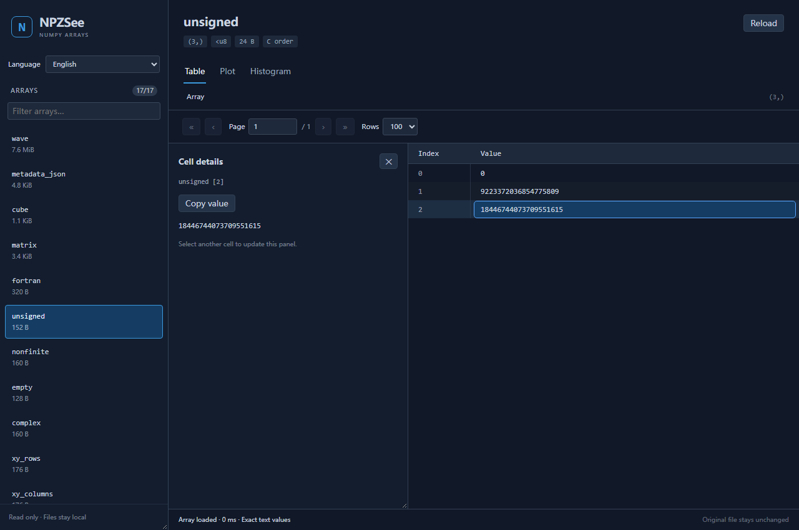
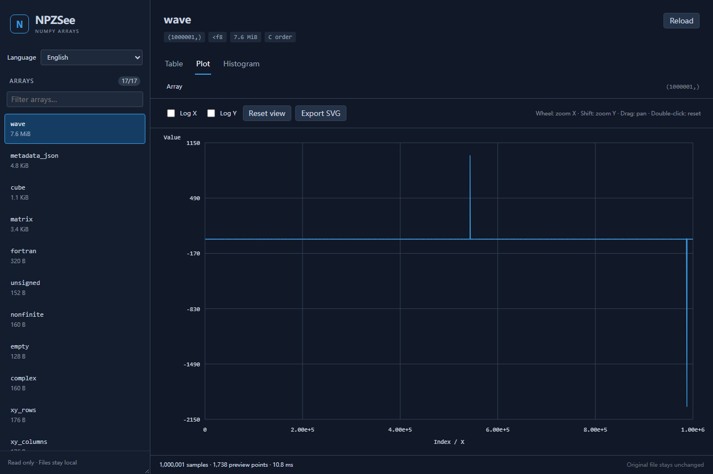

# NPZSee for VS Code

**Open NumPy files. Explore every dimension.**

NPZSee is a read-only `.npy` and `.npz` viewer for VS Code. Browse multidimensional
arrays, inspect exact values and metadata, and explore plots without writing a
Python script. A **Rust data engine** handles parsing, mapped storage, slicing and
statistics; the editor interface receives only the data it needs to display.

[简体中文](README.zh-CN.md) · [Installation](#installation) · [Building](#building) · [Marketplace preparation](docs/publishing.md)



## What you can do

- **Browse arrays on demand.** The sidebar lists NPZ members first; the selected
  array is loaded when you open it. Filter names and resize the sidebar.
- **Navigate any number of dimensions.** Descend through subarrays, inspect a
  matrix, open one row, and return using breadcrumbs. C and Fortran order share
  the same logical navigation.
- **Inspect exact values.** Tables provide row and column pagination, including
  the last element. Click a cell to open a persistent **details panel inside
  Table**, then select another cell to update it. Copy long values without a modal
  window. Signed and unsigned 64-bit integers retain all their digits.
- **Read strings and JSON.** Unicode, byte strings, scalar metadata and lazy JSON
  trees are supported. JSON numbers preserve their original numeric text.
- **Explore waveforms.** Plot vectors, selected matrix rows, or X/Y pairs from
  two rows or columns. Zoom, pan, choose a complex component, read original samples
  on index plots, switch to log axes, or export the current view as SVG.
- **Inspect distributions.** Choose sampled preview or exact full-slice
  histograms, adjust bins, inspect statistics and nonfinite counts, and export SVG.
- **Choose your language in the viewer.** 简体中文, English, Français, Español,
  Русский and العربية are included. Arabic uses a right-to-left layout while
  numeric tables retain their reading order. The initial language follows VS Code.



## Performance by design

Large arrays stay in Rust. NPY files use read-only memory mapping; selected NPZ
members are streamed into temporary files and mapped. A bounded cache avoids
repeated decompression. The UI requests paged text values, histogram bins, or a
screen-width waveform envelope rather than serializing the full array into JS.

Peak-preserving previews retain narrow spikes. Zooming an index plot asks Rust
for the visible original samples or summary blocks. Quick histograms are explicitly
labelled approximate; exact mode scans the complete selected slice in Rust.

No Python, NumPy, Qt or Matplotlib installation is needed to **use** the extension.
There is no local HTTP server. Closing a file releases its backend and mappings.
Performance depends on storage, compression, data type and hardware.

## Installation

Marketplace publication is being prepared. For now, download the VSIX matching
your system from [GitHub Releases](https://github.com/terenceyjh/NPZSee-vscode/releases).

1. In VS Code, open Extensions → **… → Install from VSIX…**.
2. Select the downloaded package and open a `.npy` or `.npz` file.
3. If another editor is selected, use **Reopen Editor With… → NPZSee**.

Available target names: `win32-x64`, `win32-arm64`, `linux-x64`, `linux-arm64`,
`darwin-x64` and `darwin-arm64`. These are **64-bit** architectures. For SSH, WSL or
containers, install the package matching the remote extension host.
See [platform requirements and validation boundaries](docs/cross-platform.md).

The pre-Marketplace packages use the temporary publisher `npzsee-local`. A final
publisher ID will be selected before the store release; it is separate from the
project name NPZSee and repository name NPZSee-vscode.

## Data support and boundaries

Common integers, float16/32/64, complex64/128, booleans, Unicode and byte strings
are supported, including byte order and C/Fortran layout. Structured records have
text previews; other fixed-width types can fall back to raw bytes. Object/pickle
arrays are not executed. Preserve dictionary metadata as Unicode JSON instead.

Cell/scalar previews are labelled when capped at two million characters. Table
previews are shorter; click to inspect more. Plot geometry and exported SVG show
the current decimated view. Sampled statistics can miss rare or periodic events.
Exact numeric inspection is available in Table.

NPZ extraction needs temporary disk space. Let writers finish before opening or
reloading a file, especially a directly mapped NPY. Source files remain read-only.
Pure browser hosts and virtual filesystem providers are outside the current scope.

## Building

Use Rust 1.96+, a native linker and Node.js 22+. Python with NumPy is needed only
for fixture generation and independent tests.

```sh
npm ci
npm run build:backend
npm run check
npm run build
npm test
npm run test:i18n
npm run package:local
```

Press F5 in this repository to launch a development window. For browser and real
VS Code interaction tests, see [testing](docs/testing.md). The CI workflow builds
and tests six native packages, and release tags attach VSIX files, checksums and
matching Rust dependency sources to a GitHub prerelease.

The release process for this project is **VSIX + Visual Studio Marketplace**.
The separate desktop project's executable/PyPI distribution is maintained elsewhere.

## License and credit

**GPL-3.0-or-later.** See [LICENSE](LICENSE) and [NOTICE](NOTICE).

NPZSee derives from the npzview Rust rewrite and VS Code prototype, which were
based on [LiukDiihMieu/npyquick](https://github.com/LiukDiihMieu/npyquick). The
upstream project's NumPy-viewing concepts and provenance are retained; this is
an independently named derivative. Third-party Rust notices are in `LICENSES/`.
Matching source archives accompany native packages. Private test data, credentials,
toolchains and build caches are excluded from source control and distribution.
